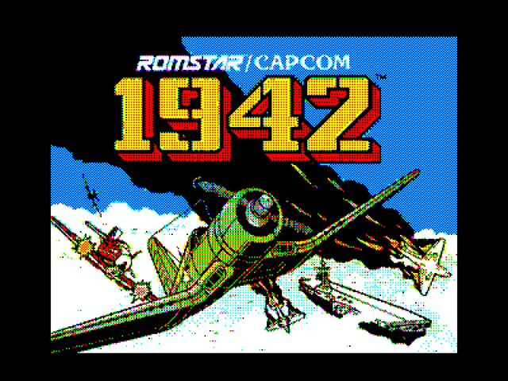
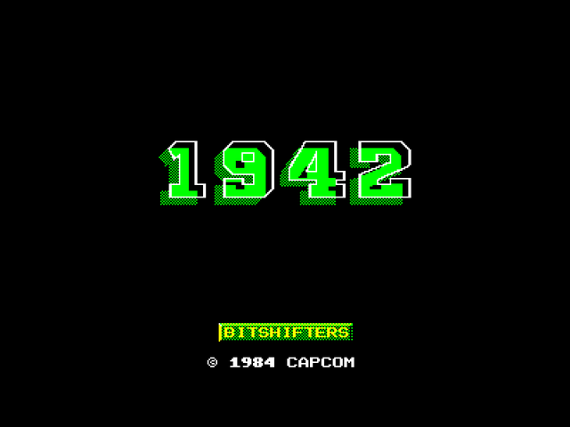
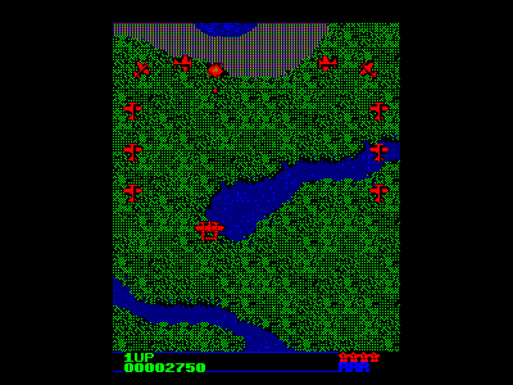
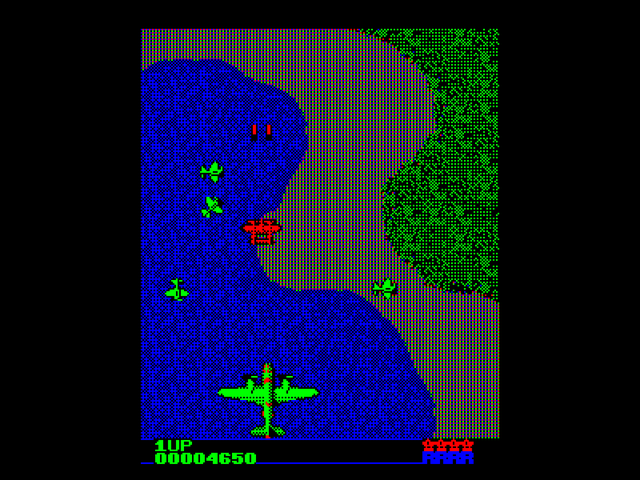
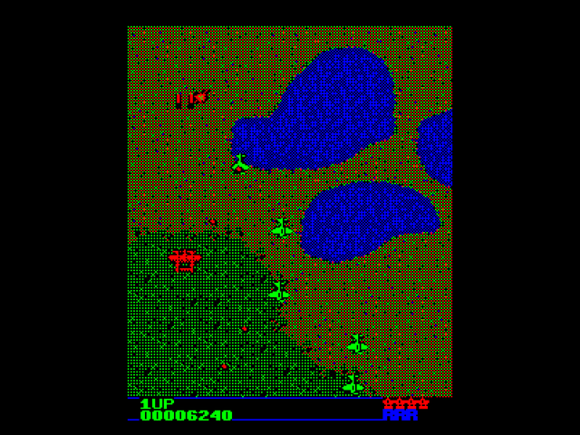
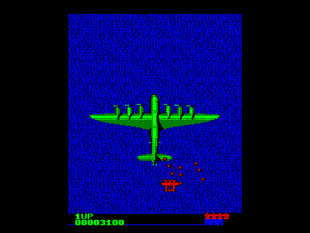

## **About**

[1942](https://en.wikipedia.org/wiki/1942_(video_game)) is Capcom's vertically scrolling shoot 'em up from 1984, the first of what became the 19XX series. You fly a P-38 off an aircraft carrier across the Pacific, through 32 stages from Midway to Okinawa, against waves of fighters, four-engined bombers and the giant Ayako. It was a big arcade hit, and home versions followed in 1986.

Growing up I spent many an hours shovelling 20p's into the arcade machine whenever I came across it. The game is simple but well balanced as a shoot'em up, with the first hint of power-up mechanics that would become more common place in later games. One unique aspect was that enemy planes flew in from all different directions, following smooth arcs around the player. This was much more interesting and challenging than just lining up to be shot in front of you, as was more typical of vertical shoot'em ups until that point.

Given the success, it was naturally ported to many 8-bit home platforms of the era, although not the BBC Micro. Many of the home ports were of mediocre quality, not a fault of the developers, they were almost certainly under extreme time pressure and were unlikely to have had access to the arcade machine itself (probably just a VHS tape of someone playing the game through, as was often the way back in those days.)

This port sets out to do two things: (1) Show that the BBC Master was at least a technically viable platform for high-quality arcade games, even if it very much wasn't commercially viable. (2) Be the most faithful and accurate conversion of the game to a home 8-bit computer, using the benefit of full access to the arcade ROMs and all the modern computing power that can be thrown at the problem. I hope you enjoy playing it as much as I enjoyed making it!

## **Port**

The arcade machine is a lot of hardware for 1984. A 4 MHz Z80 runs the game, and a second Z80 at 3 MHz drives two AY-3-8910 sound chips, six channels between them. The picture comes out on a vertically mounted monitor, 224 pixels wide and 256 tall. Hardware provides a scrolling tilemap of 16×16 background tiles, a character layer for the text, and hardware sprites. The ROMs come to 210K:

* **72K of game code**, more than the Z80 can address at once, so more than half of it is bank-switched
* **16K** for the sound CPU
* **8K of characters**: 512 8×8 characters in 4 colours
* **48K of background tiles**: 512 16×16 tiles in 8 colours
* **64K of sprites**: 512 16×16 sprites in 16 colours, 500 of them used, from the player's P-38 to the 16-tile-wide Ayako

Fifty distinct colours appear on screen across the game, and the level maps for all 32 stages come out of the code ROMs rather than the graphics.

The BBC Master has a 2 MHz 65C12, 128K of RAM, four colours in MODE 1 and an SN76489 - and no sprites or tilemap. So:

* **Solid 25Hz** gameplay, with many software sprites on screen (OK, the larger planes do cause some slowdown!)
* **Smooth scrolling** one scanline at a time with vertical rupture, double-buffered in shadow RAM.
* **Dithered graphics** from MODE 1's four colours, with black-outlined sprites.
* **Streaming from disc**: each stage's map and scripts load as you reach it, and the bomber's break-up loads mid-flight.
* **The arcade's own sound, enemy scripts and flight engines**, converted from the original ROM and checked against MAME frame by frame.

The release disc fills 759 of its 800 sectors. What made it through:

* **All 32 stages**, each on its own map, including the eight "% and Point Up" bonus stages.
* **No loading screens**: each stage streams in from disc as you land, with the music playing on.
* **204 sprite pictures**, from the smallest fighter to the four-engined bomber breaking up as it falls.
* **Every enemy wave and formation** from the arcade's level scripts, each plane flying the arcade's own flight paths - including the zig-zagging fighters of the later stages - with the red formations and their POW power-ups.
* **All four Ayako boss fights.**
* **The Yashichi bonus**, the arcade's scoring, the high-score table, name entry and continue.

As with [Paradroid](https://bitshifters.github.io/posts/prods/bs-paradroid.html), this was written with Claude Code, without my writing a line of the code directly. Thanks to my fellow Bitshifters for playtesting and encouragement.

## **How to Play**

Shoot everything, collect the POW power-ups carried by the red formations, and use your loops (the roll) to dodge out of trouble; the panel shows how many you have left. Land back on the carrier at the end of each stage for an accuracy bonus. See the [1942 strategy guide](https://strategywiki.org/wiki/1942) for more.

### Game Controls

**Player Control Keys**

BBC Computer keyboard layout (your emulator layout may vary!):

* `Z` - Left
* `X` - Right
* `K` - Up
* `M` - Down
* `L` - Fire
* `SPACE` - Loop (on the title: insert coin)
* `ESCAPE` - Quit the current game

**Additional Keys**

* `Ctrl`+`P` - Pause game
* `Ctrl`+`R` - Redefine keys (on the title and attract screens)
* `Ctrl`+`Q` - Toggle sound
* `Ctrl`+`Up` - Increase sound volume
* `Ctrl`+`Down` - Decrease sound volume
* `C` - Continue, after a game over

Note that this game requires a **BBC Master 128** and implements a sophisticated in-game streaming system. It therefore requires either a **floppy disk drive** or an **accurate floppy drive emulator**, like a Gotek. **SD card solutions other proprietary storage devices are not supported.**
