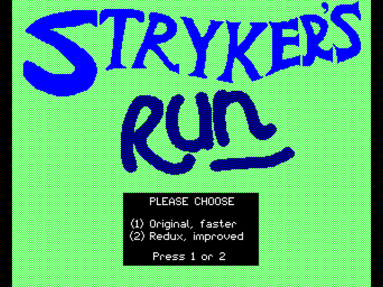
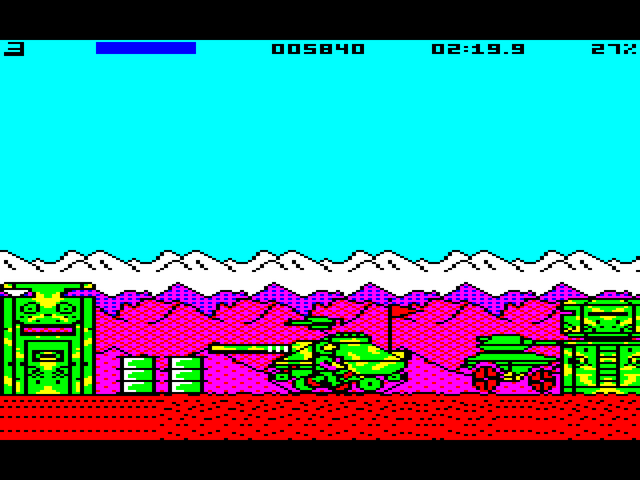
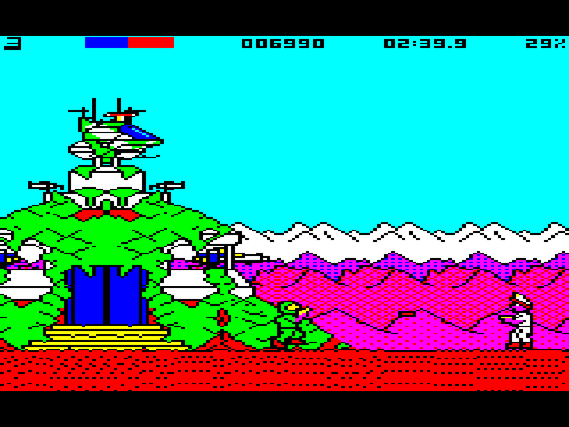
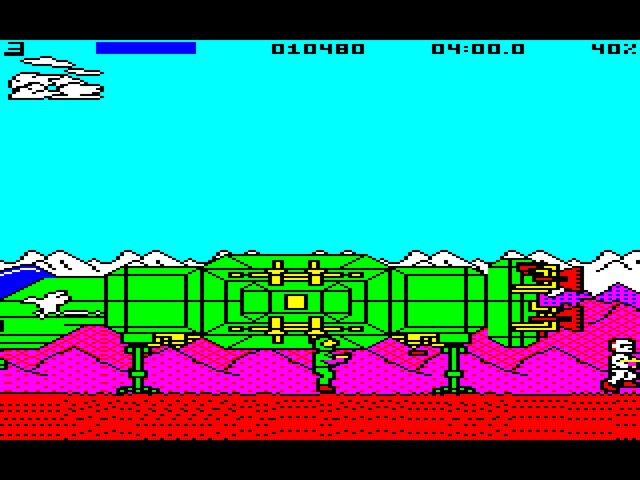
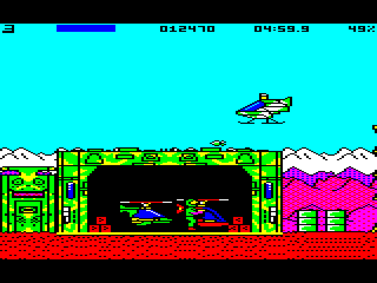
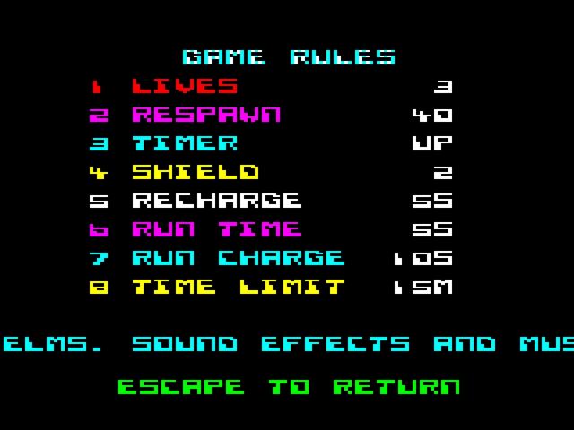

## **About**

**Stryker's Run** is Superior Software's 1986 run-and-gun for the BBC Micro: Stryker fights his way across enemy territory to headquarters, on foot, by helicopter and in a tank. Its enhanced version for the BBC Master 128 kept its graphics in the Master's sideways RAM, but ran at 15-17 frames a second with its sprites flickering.

This disc puts two versions of the enhanced game behind the original release's own menu:

**(1) Original, faster**: the game as it was, made smooth. Every frame is drawn into one of two screens in shadow RAM while the other is shown, with masked sprites, so nothing flickers, and it holds a steady 25 frames a second. A few of the original's bugs are fixed, such as one hit costing a stack of lives, but otherwise it plays as it did.

**(2) Redux, improved**: the same engine with gameplay changes:

* **A recharging shield**: a hit drains it rather than killing you outright.
* **Respawning lives**: when you die the view rewinds a short way and you carry on.
* **A run key** for short bursts of speed, and jumping and firing on the move.
* **Vehicles that take hits**: helicopters and the tank survive a few.
* **A new HUD**: score, shield bar, timer and your progress through the level.
* **Dithered hills** and new sound effects.
* **A game rules screen** for lives, rewind distance, timer, shield and run settings.

## **Redux Lite: BBC Model B**

A second disc puts both versions on a **BBC Model B with 64K of sideways RAM** (four 16K banks, in any slots).

<a href="/content/bs-strykers-run-model-b.ssd" class="btn btn-md btn-success"><i class="fa fa-download"></i> Download Model B disc</a>&nbsp;&nbsp;&nbsp;<a target='_blank' href="https://bbc.godbolt.org/?disc=https://bitshifters.github.io/content/bs-strykers-run-model-b.ssd&autoboot&model=B-DFS1.2" class="btn btn-md btn-success"><i class="fa fa-play-circle"></i> Emulate Model B</a>

The Model B has no shadow RAM to draw the next frame into, so this version shows a single screen and races the TV beam: each part of the picture is redrawn either just after the beam has passed it or before it gets there, with the player and the scroll's new column first, so tearing and flicker are down to the odd frame in the busiest scenes. The code is rewritten for the Model B's NMOS 6502, and the graphics and code the Master kept in its extra RAM are packed into the four sideways banks. Both games play exactly as they do on the Master: the same levels, rules, Redux features, dithered hills and HUD. The busiest scenes drop the odd frame more often than on the Master.

The work started from Level 7's annotated disassembly, rebuilt first as source that assembles byte for byte to the original disc, then optimised. As with [Paradroid](https://bitshifters.github.io/posts/prods/bs-paradroid.html) and [1942](https://bitshifters.github.io/posts/prods/bs-1942.html), it was written with Claude Code.

## **How to Play**

Fight your way right to headquarters. Take over helicopters and the tank where you find them; grenades and bombs clear gun nests and anything in your way.

### Game Controls

**Player Control Keys** (redefinable from the title screen, option 2)

* `Z` - Left
* `X` - Right
* `K` - Jump / move up
* `M` - Duck
* `L` - Fire laser
* `SPACE` - Grenade / bomb
* `RETURN` - Enter / leave a vehicle
* `SHIFT` - Run (Redux)
* `P` - Pause

On the Redux title screen, option 6 sets the game rules.

The first disc needs a **BBC Master 128**; the Model B disc a **BBC Model B with 64K of sideways RAM**.
