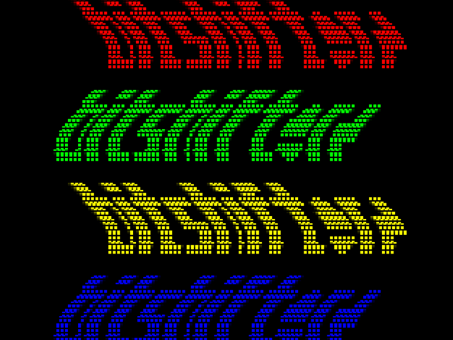
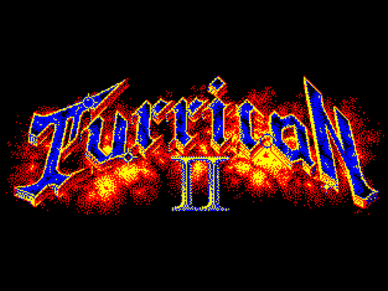
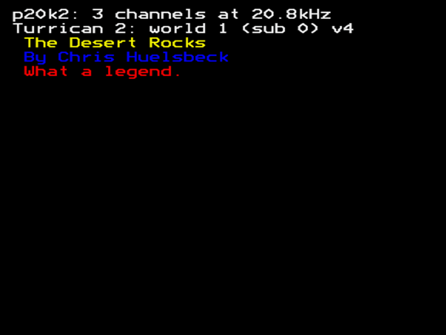

## **About**

**The Desert Rocks** is Chris Huelsbeck's world 1 music from Turrican 2 on the Amiga, converted to play on a stock **BBC Model B with 32K of RAM**. It shows off **p20k2**, a new sample player that plays three independent channels, each at **20.8kHz**, through the Beeb's SN76489 sound chip.

How it gets there:

* **The SN76489 write gate is left open**, so the chip can be written without the usual handshake.
* **The SN76489 is written every 8µs**, which became possible after reverse-engineering how the chip takes writes.
* **VIA timer 2 is used in an undocumented mode** as a variable-rate counter.
* **A lot of 6502 optimisation.**

Any cycles left over can go on a higher sample rate or on lookup tables, so more song conversions are planned, each with different trade-offs. Requests for Amiga songs are welcome on the [Stardot thread](https://stardot.org.uk/forums/viewtopic.php?t=33974).

The tricks, the player design and the 6502 player loop are Chris's own. AI helped with the tedious parts: converting Turrican 2's TFMX music to MOD format, repacking the samples, and working out each song's memory layout and volume tables. The sample conversion is tuned by hand.

Background on the techniques is on Stardot:

* [The SN76489 write gate](https://stardot.org.uk/forums/viewtopic.php?t=30838)
* [Writing the SN76489 every 8µs](https://stardot.org.uk/forums/viewtopic.php?t=33655)
* [VIA timer 2 as an "iteration co-processor"](https://stardot.org.uk/forums/viewtopic.php?t=33700)

Needs a **BBC Model B**. Turn the sound up!
