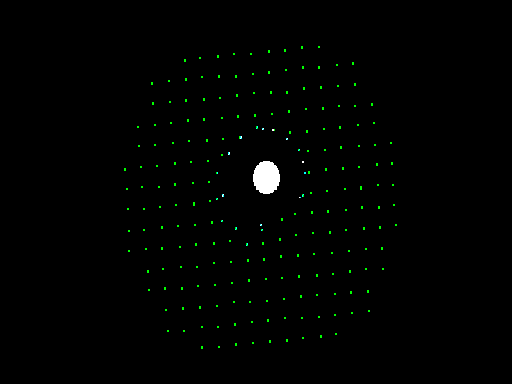
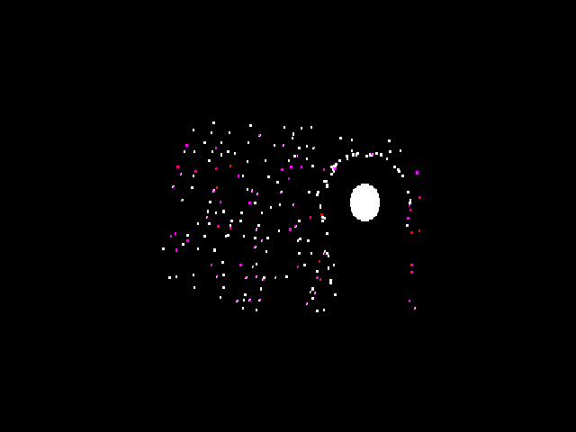
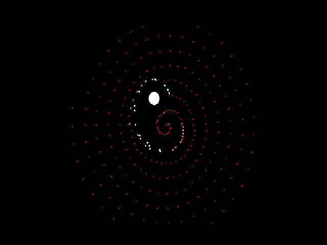
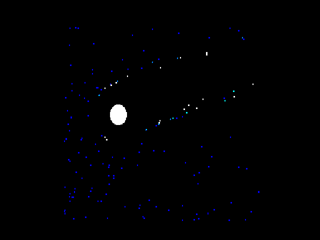
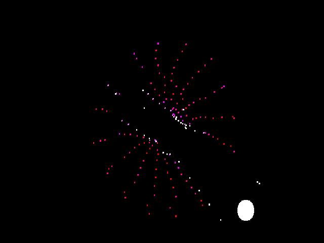
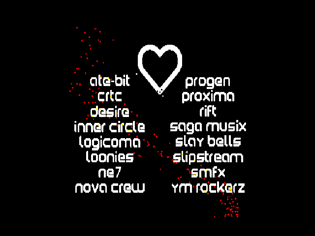

## **About**

**Push** is the 64K particle demo Bitshifters and Torment released for the Acorn Archimedes at Revision 2024. This is Push on a **BBC Master Turbo**, using both of its processors: the 4 MHz 65C102 co-processor runs the particle physics and sends the host what to draw across the Tube, and the Master's own 2 MHz 65C12 draws it in MODE 1, plays the music and runs everything else.

The original moves 490 particles at 50 frames a second. The BBC holds 25 frames a second throughout with up to about 300 particles. The music is Push's MOD converted for the SN76489, with timer-driven bit-banged bass. The demo comes in at <48Kb on disc.

## **Requirements**

A **BBC Master 128** with a **65C102 co-processor** (the Master Turbo). The Emulate button starts jsbeeb with the co-processor.

The [Archimedes original](https://bitshifters.github.io/posts/prods/bs-push.html) is on its own page.
